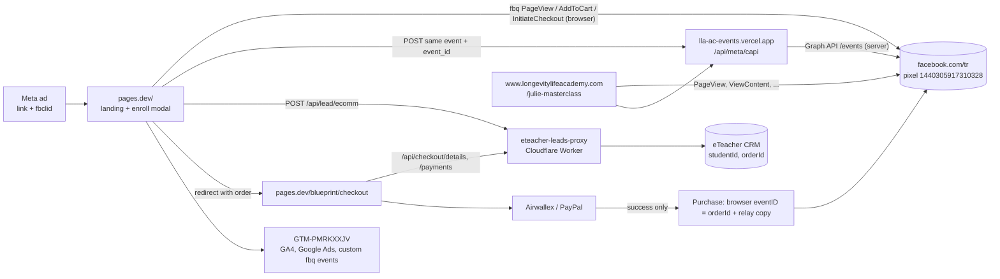

# Auditor handover: Meta tracking & checkout audit, Longevity Life Academy funnels

**Prepared:** Wed 4 Nov 2026, 20:30 Israel time (Asia/Jerusalem, UTC+2).
**For:** any outside AI coding/research tool (Claude Code, Perplexity, etc.) or human auditor with zero prior knowledge.
**Rule of the document:** you should be able to run the whole audit without asking anyone a question, and without harming anything. If something here conflicts with what you see live, trust what you see, record the difference, and do **not** "fix" it.

> **Credentials:** none are in this document. Where access is needed: *credentials provided separately by the account owner; never commit or print them.* Never paste a token, app secret, API key, cookie or password into a report, a commit, a log or a chat.

Labels used: **VERIFIED** = seen directly by the previous audit (4 Nov 2026, 18:30–19:30 Israel time). **ESTIMATE** = reasoned, not proven.

---

## 1. Purpose and scope

**Purpose.** Independently confirm, end to end, that every Meta (Facebook/Instagram ads) tracking event on the Longevity Life Academy (LLA) funnels fires correctly in the browser and on the server, deduplicates, carries good matching data, and that the checkout works up to (not including) payment. Find anything broken, missing or risky.

**In scope**
- Blueprint funnel (the paid-ads landing page): `https://longevitylifeacademy.pages.dev/`, `/blueprint/checkout`, `/checkout.html`.
- Main site `https://www.longevitylifeacademy.com/` and the masterclass page `/julie-masterclass/` (script `julie-meta-tracking.js`).
- Meta pixel/dataset `1440305917310328`, the server-side relay (CAPI), Google Tag Manager container `GTM-PMRKXXJV`.
- The CRM lead/order proxy (eTeacher) and the payment step (Airwallex, PayPal) — **observe only, never pay**.
- Read-only Meta Graph API checks on ad accounts `act_1459085242361281` (Longevity Life Academy) and, for comparison only, `act_1358975119724184` (French Atelier — a different brand; do not audit its funnel unless asked).
- Ad sets: Masterclass Set 02 `52673824399628`, Masterclass Set 04 `52668330870828`, Blueprint Lists `52666232368428`, Blueprint Interests `52669013718628`.

**Out of scope (never do):** changing anything anywhere. See section 5.

---

## 2. Glossary (every term, plain English)

| Term | Meaning |
|---|---|
| **Pixel** (dataset) | Meta's JavaScript in the browser (`fbq(...)`) that reports what a visitor does to `https://www.facebook.com/tr`. Our id: `1440305917310328`. |
| **CAPI** (Conversions API) | The same event sent server-to-server to Meta, so ad blockers and iOS privacy don't lose it. Here it goes browser → our relay → Meta. |
| **Relay** | Our small server (Vercel project `lla-ac-events`) at `https://lla-ac-events.vercel.app/api/meta/capi` that receives events from the page and forwards them to Meta CAPI. A GET returns **405** — that means "alive". |
| **event_id / eventID** | A shared id put on the browser copy (`eventID`) and the server copy (`event_id`). Meta counts the pair once. This is **deduplication (dedup)**. |
| **fbclid** | Click id Meta appends to ad links (`?fbclid=...`). |
| **fbc** | Cookie `_fbc` = `fb.1.<timestamp>.<fbclid>`, built from fbclid. Ties an event to an ad click. |
| **fbp** | Cookie `_fbp` = `fb.1.<timestamp>.<random>`, a browser id set by the pixel. |
| **EMQ / match quality** | Meta's 0–10 "Event Match Quality" score: how well an event can be matched to a person (email, phone, name, fbc, fbp, IP, user agent... hashed). |
| **test_event_code** | A code like `TEST12345` from Events Manager → Test Events. Events sent with it appear only in the Test Events tab and do **not** count for ads. |
| **ViewContent / AddToCart / InitiateCheckout / Purchase** | Standard Meta funnel events: viewed the product → started enrolling → submitted details and got an order → paid. |
| **Landing page view (LPV)** | Meta's own count of ad clicks where the page loaded. Not a pixel event. |
| **promoted_object** | The pixel + event an ad set optimises for. |
| **url_tags** | Extra query parameters (UTMs etc.) Meta appends to an ad's link. |
| **GTM** | Google Tag Manager; container `GTM-PMRKXXJV` loads extra tags (Google Ads, GA4, some custom pixel events). |
| **eTeacher CRM** | The school's student/order system (owner: eTeacher Group). Reached only via the lead proxy. |
| **Lead proxy** | Cloudflare Worker `eteacher-leads-proxy` at `https://eteacher-leads-proxy.gitter-omri.workers.dev`, which turns form submissions into CRM students/orders. |
| **Cloudflare Access gate** | A login wall that can be placed in front of a Cloudflare app. It wrongly blocked the lead proxy 3–4 Nov (section 9). |
| **Airwallex / PayPal** | Payment providers on `/blueprint/checkout`. A "payment intent" is created when the page loads; it stays unpaid (`REQUIRES_PAYMENT_METHOD`) unless a card/PayPal is actually submitted. |
| **Silenced / tester device** | A browser flagged as internal so the pixel and relay do nothing (section 4). |

---

## 3. Architecture map

### 3.1 Inventory

| Piece | Where | Host / deploy | Source code |
|---|---|---|---|
| Blueprint landing + enroll modal | `https://longevitylifeacademy.pages.dev/` (ads link here) | Cloudflare Pages project `longevitylifeacademy` (account `gitter-omri`). Live deploy at audit: `00843d57` (VERIFIED) | GitHub `gitteromri-ux/lla-course-checkout` (private). Last commits 2 Nov 21:56 & 22:52 Israel (`08cd3251` Airwallex consent, `571d476b` layout) — no tracking lines touched (VERIFIED) |
| Payment page | `https://longevitylifeacademy.pages.dev/blueprint/checkout` | same | same |
| Alternate checkout page | `https://longevitylifeacademy.pages.dev/checkout.html` | same | same |
| Main site | `https://www.longevitylifeacademy.com/` | GitHub Pages from org repo `Longevity-Academy/Longevity-Academy.github.io` (mirror `gitteromri-ux/lla-site-live`). DNS: AWS Route 53, managed by eTeacher | no commits since 31 Oct (VERIFIED) |
| Masterclass page | `https://www.longevitylifeacademy.com/julie-masterclass/` + `julie-meta-tracking.js` | GitHub Pages, repo `Longevity-Academy/julie-masterclass` (mirror `gitteromri-ux/julie-masterclass-live`) | — |
| CAPI relay | `https://lla-ac-events.vercel.app/api/meta/capi` (also `/api/ac/event` for ActiveCampaign) | Vercel team `gitter1`, project `lla-ac-events`; last deploy 27 Sep (VERIFIED) | `api/meta/capi.js`, `lib/blueprint-golden-capi.js`, `lib/julie-capi.js`, `lib/click-id.js` |
| Lead / order proxy (CRM) | `https://eteacher-leads-proxy.gitter-omri.workers.dev` — `POST /api/lead/ecomm` (creates student + order), `POST /api/checkout/details`, `POST /api/checkout/payments` (+ legacy `/leads/production`, `/leads/staging`) | Cloudflare Worker `eteacher-leads-proxy` | Worker code (owner's Cloudflare account) |
| CRM | eTeacher Group back office | eTeacher | not accessible; observe via proxy responses only |
| Payments | Airwallex drop-in (`checkout.airwallex.com`), PayPal SDK (`www.paypal.com/sdk/js`) | eTeacher's merchant accounts | — |
| GTM | `GTM-PMRKXXJV` (version 22, unchanged since 29 Oct, VERIFIED) | Google | — |
| Pixel | `1440305917310328`, in business "ETeacher Group LTD" | Meta | — |
| Ad accounts | `act_1459085242361281` (LLA), `act_1358975119724184` (French Atelier) | Meta | — |
| Email marketing | ActiveCampaign (eTeacher account) | — | never touch |

Other hosts allowed by the relay (CORS): `https://longevitylifeacademy.com`, `https://lla-checkout.gitter-omri.workers.dev` (older Worker checkout).

### 3.2 Data flow



ASCII fallback:
```
Meta ad (fbclid) -> pages.dev/  --browser fbq--> facebook.com/tr (pixel 1440305917310328)
                       |  \--POST event_id--> lla-ac-events.vercel.app/api/meta/capi --server--> Meta CAPI
                       |--POST /api/lead/ecomm--> eteacher-leads-proxy (CF Worker) --> eTeacher CRM
                       v
              pages.dev/blueprint/checkout --/api/checkout/*--> proxy ;  Airwallex / PayPal
                       \-- on payment success only: Purchase (browser + relay, eventID = CRM orderId)
www.longevitylifeacademy.com (+ /julie-masterclass) --> pixel (PageView, ViewContent via julie-meta-tracking.js) + relay
```

---

## 4. Events per page, test silencing

### 4.1 Event map (VERIFIED unless marked)

| Page | Event | Browser (pixel) | Server (relay) | eventID pattern | When |
|---|---|---|---|---|---|
| pages.dev/ | PageView | yes | yes | `lla_pageview_<ms>_<rand>` (e.g. `lla_pageview_1793810183669_nbsqlx`) | load |
| pages.dev/ | ViewContent | **no** | **no** | — | never (finding F1) |
| pages.dev/ | AddToCart | yes | yes | `lla_addtocart_...` | Enroll → details → Continue; value 79 USD |
| pages.dev/ | InitiateCheckout | yes | yes | `lla_initiatecheckout_...` | after CRM order created (`/api/lead/ecomm` 200) |
| pages.dev/ | custom (`Clicked_on_Enroll`, `Enroll_CTA_Click`, `Clicked_on_curriculum`, ...) | via GTM / page | some | — | clicks |
| /blueprint/checkout | PageView | yes | no | — | load |
| /blueprint/checkout | Purchase | yes | yes | eventID = **CRM orderId** | only after Airwallex/PayPal success (code present, not fired in audit) |
| /checkout.html | PageView | yes | no | — | load |
| www…com/ | PageView | yes (GTM) | no | — | load |
| /julie-masterclass/ | PageView, ViewContent, + checkout events | yes | yes (strict `julie-capi` module) | see `julie-meta-tracking.js` | — |

**Relay rules (`api/meta/capi.js`):**
- Allowed EVENTS: `Purchase, InitiateCheckout, AddToCart, Lead, PageView, Clicked_on_curriculum, Clicked_on_Enroll, Enroll_CTA_Click, Clicked_on_Enroll_Pricing, About_Us, Visited_one_of_the_six_pillars`. Anything else → `400 {"error":"unknown_event"}`. **ViewContent is not allowed.**
- Requests from origin `https://longevitylifeacademy.pages.dev` with page path `/`, `/index.html`, `/checkout`, `/checkout.html` and event AddToCart/InitiateCheckout/Purchase go to the frozen "blueprint golden" handler (response header `x-lla-release: blueprint-golden-20260927`). Julie masterclass requests go to `lib/julie-capi.js`. Everything else uses the general handler.
- Body fields: `event_name, event_id, email, phone, fn, ln, st, country, external_id, value, currency, order_id, url, fbp, fbc` (PII is SHA-256 hashed server-side; country also from geo headers).
- `fbp` kept if valid; `fbc` checked against the click id in `url`; response header `x-lla-fbc` reports the fbc state.
- `test_event_code` optional; must match `^TEST\d{3,10}$` else `400 invalid_test_event_code`. With a valid code the event goes to Test Events only.
- GET → 405 (alive check). OPTIONS → 204.

### 4.2 Test-silencing rules (why your test might show "nothing")
In the page `<head>` (VERIFIED in deployed HTML):
- `?llatest=1` or `?qa=1` in the URL → device is flagged (`localStorage.lla_tester = '1'`) and **stays silent on every later page**. `?llatest=0` clears it.
- Typing an email matching `@example.(com|org|net)`, `@test.com`, `@mailinator.com`, `@eteacher*.*`, `@gita-agency.*`/`@gitaagency.*`, or anything containing `gitter` → device silenced immediately (pixel replaced with a no-op, relay disabled).
- Pixel only runs on `longevitylifeacademy.pages.dev` / `*.longevitylifeacademy.com` (or with `?llapixel=1`).

**Why it matters:** (a) it protects ad data from internal tests — good; (b) with the approved test email `qa.audit.test+<tag>@example.com` you will see **only PageView and auto click events**, never AddToCart/InitiateCheckout, and you must not conclude "tracking broken"; (c) a real buyer with such an email is invisible to Meta (acceptable by design). (d) Clear localStorage between runs, or your "live" run is silently a test run.

---

## 5. HARD SAFETY RULES (non-negotiable)

1. **Never complete a real payment.** Stop on `/blueprint/checkout` once the Airwallex/PayPal widget renders. Never type a card, never click Pay, never log in to PayPal.
2. **Never submit real-looking leads to the CRM.** The only email allowed in a real submission is `qa.audit.test+<tag>@example.com` (name "QA Audit Test", phone `+1 201 555 0123`). For any run with a normal-looking email ("dry run"), you **must block** all requests to `eteacher-leads-proxy.gitter-omri.workers.dev`, `lla-ac-events.vercel.app`, `facebook.com/tr`, `connect.facebook.net` events, `checkout.airwallex.com`, `paypal.com` at the browser level (Playwright `page.route(..., r => r.abort())` or DevTools request blocking) and record them instead.
3. **Never send events to the production pixel except from silenced test runs.** To test CAPI for real, use a Test Events `test_event_code` (from Events Manager → dataset 1440305917310328 → Test Events; credentials/access provided separately by the account owner; never commit or print them).
4. **No changes** to Meta ads, ad sets, budgets, audiences, the sites, repos, DNS, Cloudflare, Vercel, GTM, ActiveCampaign or emails. Do not push, deploy, redeploy, or open PRs.
5. **Meta API is read-only: HTTP GET only.** Never POST/DELETE to graph.facebook.com (the token is ads_read anyway).
6. **Log every test order created** (time Israel, device, email tag, StudentId, OrderId, PaymentID) in the report so the owner can cancel them in the CRM.
7. Keep volume tiny: at most one real (test-email) order per device type per audit.
8. Never print secrets; never request them from any website or person.

---

## 6. End-to-end audit procedure

### 6.0 Setup
- Tools: Playwright (Chromium + WebKit) or real devices with Safari Web Inspector / Chrome remote debugging; a HAR recorder.
- Device profiles: iPhone 13/15 (WebKit, Safari UA), Pixel 7 (Chromium, Android UA), Desktop Chrome 1440×900.
- Fresh browser context per run (no cookies, empty localStorage).
- Fake click id tag: `IwQA_audit<YYYYMMDD><device>`.

**Landing URL (live-observation run, dry):**
```
https://longevitylifeacademy.pages.dev/?fbclid=IwQA_audit20261105ios&utm_source=Facebook&utm_medium=Topic&utm_campaign=audit_test
```
**Landing URL (silenced run, real CRM order allowed with test email):**
```
https://longevitylifeacademy.pages.dev/?fbclid=IwQA_audit20261105ios&llatest=1
```
Also load: `https://longevitylifeacademy.pages.dev/checkout.html`, `https://www.longevitylifeacademy.com/`, `https://www.longevitylifeacademy.com/julie-masterclass/` (each with the same fbclid).

### 6.1 Run A — Dry run (observe pixel + relay, nothing leaves)
Route rule: **allow** page/static/GTM loads; **abort and log** (method, URL, post body) every request to `facebook.com/tr*`, `lla-ac-events.vercel.app/*`, `eteacher-leads-proxy.gitter-omri.workers.dev/*`, `*.airwallex.com/*`, `*paypal.com/*`. Use a normal-looking fake email that is *not* in the silencing list, e.g. `jordan.lee.audit@outlook.com` — because requests are blocked, nothing is created. Note: since `/api/lead/ecomm` is blocked, the flow stops before InitiateCheckout; you can fulfil it with a mocked `200` `{"studentId":"0","orderId":"0"}` via `route.fulfill` to observe InitiateCheckout firing (still nothing leaves).

| Step | Action | Expected (captured, blocked) |
|---|---|---|
| 1 | open landing URL | `_fbc` cookie = `fb.1.<ts>.IwQA_audit...`; `_fbp` set; `facebook.com/tr?id=1440305917310328&ev=PageView&eid=lla_pageview_...`; relay POST `event_name":"PageView"` with **same** event_id, `fbc` present |
| 2 | scroll full page | No ViewContent (known F1). Record if one appears (would mean code changed) |
| 3 | click Enroll → fill name/email/country/phone → Continue | `ev=AddToCart` value 79 USD, `eid=lla_addtocart_...`; relay POST AddToCart same id; email/phone in relay body (hashed by relay) |
| 4 | pick a start date → Continue | POST `/api/lead/ecomm` (blocked or mocked). If mocked 200: `ev=InitiateCheckout eid=lla_initiatecheckout_...` + relay copy |
| 5 | stop | do not continue to payment in the dry run |

### 6.2 Run B — Silenced real run (checks the CRM + checkout path)
Use `?llatest=1` and email `qa.audit.test+<tag>@example.com`. Do not block the proxy. Expected:
1. Landing: browser silent (no `facebook.com/tr` from page code, relay not called). Any pixel hit here = **silencing bug** (critical finding).
2. Continue (details): no AddToCart sent.
3. Continue (date): `POST /api/lead/ecomm` → 200 JSON with StudentId/OrderId; then `/api/checkout/details` 200. **Log the ids.** A 302/HTML login page = Cloudflare Access gate is back (critical).
4. Redirect to `/blueprint/checkout`: Airwallex customer + payment intent created (status `REQUIRES_PAYMENT_METHOD`), PayPal button renders. **STOP HERE.** Screenshot, close the tab. Do not click Pay.

### 6.3 Per device
Repeat A and B on iPhone Safari (WebKit — check `_fbc` survives ITP; check InitiateCheckout fires *before* navigation), Android Chrome, Desktop Chrome (previous audit: browser InitiateCheckout sometimes lost because the page navigated first — re-check; server copy did arrive).

### 6.4 Other pages
For `checkout.html`, `.com/` and `/julie-masterclass/`: capture PageView (and ViewContent on julie-masterclass), relay calls, eventIDs, and whether GTM fires extra fbq events. Do not submit forms on .com without the test email + `?llatest=1`.

---

## 7. Verifying CAPI

1. **Relay request:** in Run A capture body; confirm `event_name`, `event_id` (equals browser `eid`), `url` (contains fbclid), `fbc`, `fbp`, `external_id`, `value`, `currency`.
2. **Relay response (only for permitted live calls):** expect `200` and headers `x-lla-release`, `x-lla-fbc` (e.g. `match`/`ok`). `400 unknown_event` → event not in EVENTS.
3. **Supervised test (optional, needs owner-provided Test Events code):** `curl -X POST https://lla-ac-events.vercel.app/api/meta/capi -H 'Origin: https://longevitylifeacademy.pages.dev' -H 'Content-Type: application/json' -d '{"event_name":"PageView","event_id":"lla_pageview_audit_<ts>","url":"https://longevitylifeacademy.pages.dev/?fbclid=IwQA_audit","test_event_code":"TEST<code>"}'` → event appears **only** in Events Manager → Test Events. Use PageView only. Never send Purchase.
4. **Dedup in Events Manager:** (read-only UI) Overview → event → "Deduplication" should show browser+server pairs; Purchase browser/server split ~1:1.
5. **Match quality:** Events Manager → event → Event Match Quality (target ≥ 6 for Purchase/IC); parameters coverage (email, phone, fbc, fbp, external_id, IP, UA).
6. **Alive check:** `curl -i https://lla-ac-events.vercel.app/api/meta/capi` → 405.

---

## 8. Read-only Graph API checks (GET only)

Token: credentials provided separately by the account owner; never commit or print them. Pass it via an env var (`$META_TOKEN`) and never echo it. Version `v21.0`. Time zone of results: convert to Israel time.

```bash
G=https://graph.facebook.com/v21.0
# Pixel stats by event, hourly
curl -s "$G/1440305917310328/stats?aggregation=event&start_time=$(date -d '-72 hours' +%s)&access_token=$META_TOKEN"
# by source (browser vs server)
curl -s "$G/1440305917310328/stats?aggregation=event_source&start_time=$(date -d '-24 hours' +%s)&access_token=$META_TOKEN"
# by host (which domain sends what)
curl -s "$G/1440305917310328/stats?aggregation=host&access_token=$META_TOKEN"
# Pixel diagnostics
curl -s "$G/1440305917310328/da_checks?access_token=$META_TOKEN"
# Ad set config / promoted_object
for A in 52673824399628 52668330870828 52666232368428 52669013718628; do
 curl -s "$G/$A?fields=name,status,effective_status,promoted_object,optimization_goal,attribution_spec,daily_budget&access_token=$META_TOKEN"; done
# Ads: links and url_tags
curl -s "$G/52666232368428/ads?fields=name,effective_status,url_tags,creative{object_story_spec,asset_feed_spec,url_tags}&access_token=$META_TOKEN"
# Hourly insights for today (Israel time = account tz check: GET act_1459085242361281?fields=timezone_name)
curl -s "$G/52669013718628/insights?date_preset=today&breakdowns=hourly_stats_aggregated_by_advertiser_time_zone&fields=spend,impressions,clicks,actions&access_token=$META_TOKEN"
# Account-level
curl -s "$G/act_1459085242361281/insights?date_preset=last_7d&level=adset&fields=adset_name,spend,actions,action_values&access_token=$META_TOKEN"
```
Expected: promoted_object `{"pixel_id":"1440305917310328","custom_event_type":"PURCHASE"}`; optimisation OFFSITE_CONVERSIONS; 7-day click/1-day view. Note: `last_fired_time` may fail if the token lacks rights on the pixel's owner business — record, don't work around.

---

## 9. Known findings so far (audit of 4 Nov 2026)

| # | Finding | Label |
|---|---|---|
| F1 | **No ViewContent on the ad landing page** `pages.dev/` in any deploy since 7 Oct; relay EVENTS also rejects ViewContent. All ViewContent in the ad sets came from `.com/julie-masterclass`. | VERIFIED |
| F2 | **Checkout gate outage:** the CRM proxy was behind a Cloudflare Access gate from about **3 Nov 21:00 to 4 Nov 16:09 Israel time**; no InitiateCheckout/Purchase (and no AddToCart) possible. Pixel stats show none from 3 Nov 22:00 until 4 Nov 17:00. | VERIFIED (AddToCart dependency: ESTIMATE) |
| F3 | **8 of 10 active ads have no UTMs** (url_tags). Only Ad#3 Courtney (Lists) and Ad#12 Julie (Interests) have them. fbclid still works for the pixel; the CRM can't attribute campaign. | VERIFIED |
| F4 | **Test orders already created** (QA Audit Test, `qa.audit.test+trk1104@example.com`, ~18:36 Israel 4 Nov): Desktop StudentId 11689824 / **OrderId 8071556** / PaymentID 64718479; Android 11689825 / **8071557** / 64718489; iPhone 11689826 / **8071558** / 64718499. Airwallex intents left unpaid. Need cleanup. | VERIFIED |
| F5 | Desktop: browser InitiateCheckout not captured before navigation (server copy arrived). | VERIFIED once; cause ESTIMATE |
| F6 | Pixel diagnostics only catalog warnings ("content_ids don't match a catalog", "missing DPA parameters"). | VERIFIED |
| F7 | Low traffic per ad set (1–11 LPV/day) makes zero events normal noise; attribution can lag hours. | ESTIMATE |

---

## 10. Open questions for the auditor

1. Is the proxy now reachable without the Access gate on all paths (`/api/lead/ecomm`, `/api/checkout/details`, `/api/checkout/payments`)? Any uptime monitor?
2. Does browser InitiateCheckout fire reliably before redirect on desktop and iOS? (Is `sendBeacon`/await used?)
3. Do Purchase browser and server copies share event_id = orderId, and is the split ~1:1 in Events Manager for the last 7 days?
4. EMQ per event (PageView, AddToCart, InitiateCheckout, Purchase) — values and missing parameters.
5. Does `_fbc` persist from landing to `/blueprint/checkout` on iOS Safari? Is `fbc` on the Purchase relay call?
6. Since 4 Nov 16:09, do AddToCart/InitiateCheckout/Purchase appear per ad set in insights?
7. Are there duplicate pixel loads or double PageViews (page + GTM)?
8. Do any other pixels or IDs fire anywhere? (Expect only 1440305917310328 on LLA pages.)
9. Is the silencing logic working (no events from `?llatest=1` / test email) — and is it too broad for real buyers?
10. Is `checkout.html` still used by any ad or link, or is it legacy?
11. Which page should receive ViewContent, and with what content_ids/value?
12. Any consent banner (Airwallex consent commit `08cd3251`) blocking the pixel in some regions?

---

## 11. Report template

```markdown
# LLA Meta tracking & checkout audit — <date>, <auditor>
Times: Israel (Asia/Jerusalem). Labels: VERIFIED / ESTIMATE.

## Bottom line (3 lines)

## Safety log
- Real payments: none
- Requests blocked in dry runs: <count>
- Test orders created: | time (Israel) | device | email tag | StudentId | OrderId | PaymentID |
- Events sent to production pixel from non-silenced runs: none
- Test Events code used: yes/no (code not printed)

## Results per device
| Step | iPhone Safari | Android Chrome | Desktop | Expected | Pass? |
| PageView browser+server, same eid | | | | | |
| ViewContent | | | | none (F1) | |
| AddToCart | | | | | |
| /api/lead/ecomm 200 | | | | | |
| InitiateCheckout browser+server | | | | | |
| Checkout page renders (stopped) | | | | | |
| Silenced run silent | | | | | |
## CAPI / dedup / EMQ
## Graph API findings (stats, promoted_object, url_tags, hourly)
## Status of F1–F7
## New findings (severity: critical / high / medium / low, evidence link, suggested fix — PROPOSAL ONLY)
## Answers to open questions
## Evidence (HAR files, screenshots, no secrets)
```

---
*Source of known findings:* https://gitteromri-ux.github.io/julie-ceo-daily/tracking-audit-2026-11-04/
